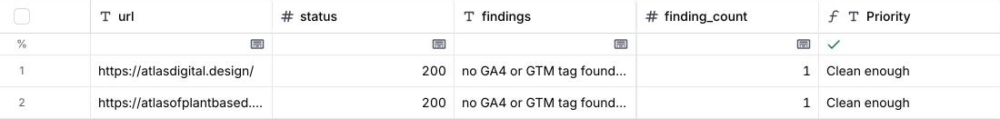
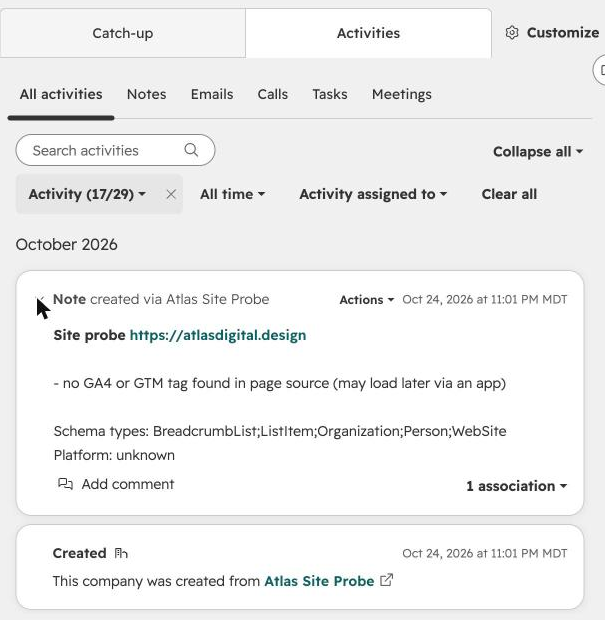

# atlas-site-probe

A small, read-only checker for the problems that break small online stores without anyone noticing. Point it at a list of sites. It fetches each page the way a crawler would and reports what it finds, one row per site. Rows can go to a CSV for a Clay table, and sites with problems can go straight into a HubSpot CRM as a company record with a note.

I built it from the scripts I use to audit house plan stores and other small catalogs before I contact them. The checks are the ones that keep turning up on real sites.

## What it checks

| Check | Why it matters |
|---|---|
| HTTP status and final URL after redirects | A product page that redirects or errors loses the visitor and the search listing. |
| Canonical tag: missing, duplicated, or pointing at another URL | Search engines index the page the canonical names. A wrong one hides the page you meant to rank. |
| `noindex` in the robots meta tag or the `X-Robots-Tag` header | The header version is easy to forget and invisible in the page source. |
| JSON-LD blocks, how many parse, and which schema types they declare | A block with one stray comma is ignored completely, and nothing on the page shows it. |
| GA4, Google Ads, Google Tag Manager and Meta pixel IDs in the page source | Shows which tags load with the page. See the limits below. |
| H1 count and title | Basic page structure. |
| Platform (Shopify, WordPress, Squarespace, Wix) and, on Shopify, whether `/cart` answers | A store whose cart errors is not a store. |

Every result also gets a plain-language list of findings, such as `canonical points to a different URL` or `1 structured data block(s) do not parse`, so a row reads as a short audit.

## Run it

Python 3.10 or newer, standard library only.

```bash
# one site, results to the terminal
python -m atlas_site_probe example.com

# a list of sites (one per line), results to CSV and JSON
python -m atlas_site_probe sites.txt --csv results.csv --json results.json
```

If every site comes back with `certificate verify failed`, your Python has no root certificates. This is common with Python from python.org on macOS. Run `Install Certificates.command` from the `/Applications/Python 3.x/` folder once, or `pip install certifi`; the probe uses certifi automatically when it is installed.

## Into Clay

Import `results.csv` into a Clay table (Import, then CSV). Each column becomes a Clay column: `finding_count`, `noindex`, `jsonld_broken`, `schema_types`, `tag_ga4` and the rest. From there, add a formula column to sort or score sites, or enrich the domain with Clay's own sources.

A scoring column I use, as a Clay formula column:

```
({{noindex}} === "True" || Number({{status}}) >= 400 || Number({{jsonld_broken}}) > 0) ? "Fix first" : (Number({{finding_count}}) >= 2 ? "Worth a look" : "Clean enough")
```



The CSV import works on Clay's free plan. Clay's HTTP API and webhook columns, which would let a table call the probe directly, are on its Growth plan (Clay pricing page, October 2026), so this repo uses the file route.

## Into HubSpot

Create a service key in HubSpot (Development, then Keys, then Service keys) with the scopes `crm.objects.companies.read` and `crm.objects.companies.write`. New HubSpot accounts use service keys; older accounts can use a legacy private app token the same way. If HubSpot refuses the note with a 403, the error names the scope it wants; add it to the key and run again. Then:

```bash
export HUBSPOT_TOKEN=your-service-key

# see what would be sent, without sending anything
python -m atlas_site_probe sites.txt --csv results.csv --dry-run

# send every site with at least two findings
python -m atlas_site_probe sites.txt --csv results.csv --hubspot --min-findings 2
```

For each site over the threshold, the probe looks up the company by domain, creates it if it doesn't exist, and attaches a note listing the findings. It never deletes a record or changes an existing company's fields. This works on HubSpot's free CRM. The company name comes from the page title, cut at the first separator, so "Acme · Shoes for runners" becomes "Acme".



## Tests

```bash
python -m unittest discover -s tests -t .
```

Each fixture in `tests/fixtures/` carries one known defect: a JSON-LD block with a trailing comma, two canonicals that point away from the page, a `noindex` meta tag, a `noindex` header served over a local HTTP server, a 404, and an unreachable host. The tests check that the probe reports each defect and that the clean page reports nothing. The HubSpot tests run in dry-run mode and send nothing.

## Limits

The probe reads the HTML the server sends. Tags that a store's apps or a tag manager inject after the page loads won't appear in the source, so a missing GA4 tag is reported as "not found in page source", which may not mean it's missing from the live site. Treat that finding as something to check in a browser, not a conclusion.

It reads one page per URL you give it. To audit a product page, give it a product URL.

It identifies itself with its own user agent and makes at most two requests per site (the page, and `/cart` on Shopify stores).

## About

Built by Jeff Combs, Atlas Digital Design, Denver. Work at [atlasdigital.design](https://atlasdigital.design).
